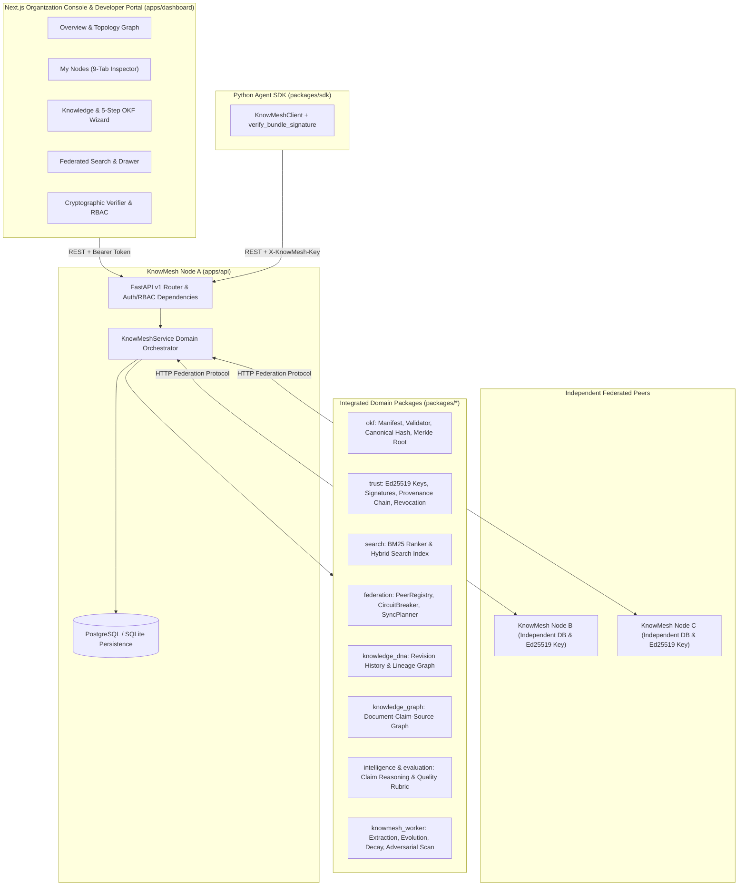

# KnowMesh System Architecture

## 1. High-Level Architecture

---

## 2. Persistence Schema (`packages/knowledge`)

The SQLAlchemy 2.0 schema in `packages/knowledge/src/knowmesh_knowledge/models/enterprise.py` persists:

1. **Identity & Multi-Tenancy**: `organizations`, `users`, `memberships`
2. **Independent Nodes & Cryptography**: `nodes`, `node_keys` (Ed25519 public/private keys, fingerprints, rotation & revocation state)
3. **AI Agents & Credentials**: `agents`, `credentials` (SHA-256 secret hashes, prefixes, scopes, expiration, revocation)
4. **OKF Knowledge & Immutable Revisions**: `knowledge_collections`, `knowledge_bundles`, `knowledge_revisions` (canonical digest, Merkle root, Ed25519 signature envelope, full OKF manifest), `claim_records`, `evidence_records`
5. **Provenance & Federation**: `provenance_events` (hash-chained records), `peer_connections`, `peer_capabilities`, `sync_records`
6. **Governance & Operations**: `access_policies`, `audit_events`, `background_jobs`

---

## 3. Cryptographic Signing & Verification Pipeline

1. **Canonicalization**: When a knowledge bundle is published, `OKFManifest.canonical_payload()` extracts the canonical fields (`bundle_id`, `title`, `version`, `format_version`, `publisher_id`, `description`, `claims`, `evidence`, `links`, `metadata`) and serializes them deterministically with sorted keys and UTF-8 encoding (`packages/okf/hashing.py`).
2. **Digest & Merkle Root**: A deterministic `sha256:<hex>` content digest and a Merkle root over claim/evidence leaves are computed.
3. **Ed25519 Signing**: `sign_object` (`packages/trust/signing.py`) signs `knowmesh-okf-bundle:<canonical_bytes>` using the publishing node's active Ed25519 keypair.
4. **Verification on Retrieval**: Both local inspection and remote peer retrieval (`retrieve_remote_bundle`) recompute the canonical OKF digest and verify the Ed25519 signature against the signer's public key before accepting or storing a revision. Tampered payloads are rejected immediately.

